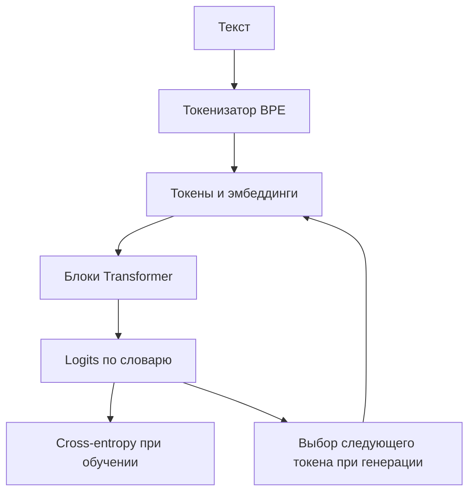

# Как обучить свою LLM с нуля на PyTorch — практический гайд по MiniMind

Русскоязычный курс по созданию языковой модели. Пройдём путь от корпуса в JSONL и случайно инициализированного Transformer до локального чат-бота: предобучение, supervised fine-tuning (SFT), генерация и оценка ответов. В качестве реализации используем [MiniMind 3](https://github.com/jingyaogong/minimind).

Практика начинается с небольшого прогона на CPU. После него можно обучить Dense-модель примерно на 64 млн параметров на NVIDIA GPU или заменить стандартные данные своим русскоязычным корпусом. Разбор архитектуры поможет проследить, как из последовательности токенов получаются logits и где именно обновляются веса.

## Содержание

- [Что именно мы обучаем](#что-именно-мы-обучаем)
- [Установка PyTorch и MiniMind](#установка-pytorch-и-minimind)
- [Первый прогон LLM на CPU](#первый-прогон-llm-на-cpu)
- [Предобучение и SFT на GPU](#предобучение-и-sft-на-gpu)
- [Как устроен Transformer в MiniMind](#как-устроен-transformer-в-minimind)
- [Как подготовить русский датасет для LLM](#как-подготовить-русский-датасет-для-llm)
- [Как проверить качество модели](#как-проверить-качество-модели)
- [Ошибки обучения и диагностика](#ошибки-обучения-и-диагностика)
- [Проверка датасета перед обучением](#проверка-датасета-перед-обучением)
- [Как локализовать поломку обучения](#как-локализовать-поломку-обучения)
- [Продвинутые эксперименты с MiniMind](#продвинутые-эксперименты-с-minimind)
- [Итоговый проект](#итоговый-проект)

## Что именно мы обучаем

| Этап | Вход | Что обновляется | Как проверить |
| --- | --- | --- | --- |
| Токенизация | Текст | В основном маршруте используется готовый BPE-токенизатор | Сравнить текст с результатом encode → decode |
| Предобучение | Обычные тексты | Все параметры, начиная со случайных весов | Loss на отложенных документах и продолжения текста |
| SFT | Диалоги с ролями | Все параметры поверх своего pretrain-чекпойнта | Ответы на инструкции, соблюдение формата |
| Инференс | Текст или сообщения чата | Веса заморожены | Генерация из сохранённого чекпойнта |

«С нуля» здесь относится к весам нейросети. Первый маршрут использует словарь и шаблон чата MiniMind. Вариант со своим словарём разобран ниже. Заявленные авторами «2 часа» относятся к одному проходу SFT на RTX 3090. Время предобучения и подготовки корпуса считается отдельно.

## Установка PyTorch и MiniMind

Команды рассчитаны на Bash под Linux или WSL2 с Python 3.11. В блоке установки показан вариант для CPU. Для обучения на GPU замените строку с установкой torch командой для CUDA из официального установщика. Держите исходники MiniMind в отдельной папке. Для воспроизводимости зафиксирована ревизия исходного проекта.

```bash
git clone https://github.com/jingyaogong/minimind.git minimind
cd minimind
git checkout --detach 2de2308d71750b44d56fd28cd8756239eee18957
python3.11 -m venv .venv
source .venv/bin/activate
python -m pip install torch==2.6.0 --index-url https://download.pytorch.org/whl/cpu
python -m pip install -r requirements.txt
python -m pip check
python -c 'import torch; print(torch.__version__, torch.version.cuda, torch.cuda.is_available())'
```

Для GPU последняя команда должна вывести `True`. Сверьте драйвер через `nvidia-smi` и при необходимости подберите сборку PyTorch через [официальный установщик](https://pytorch.org/get-started/locally/). Перед первым запуском из корня можно проверить, что версия скриптов и флаги совпадают с гайдом.

```bash
(cd trainer && python train_pretrain.py --help)
(cd trainer && python train_full_sft.py --help)
python eval_llm.py --help
```

| Где смотреть | Что там происходит |
| --- | --- |
| `model/model_minimind.py` | Конфигурация, attention, Transformer и расчёт loss |
| `dataset/lm_dataset.py` | Чтение JSONL, токенизация, маска ответов SFT |
| `trainer/train_pretrain.py` | Цикл обучения языковой модели |
| `trainer/train_full_sft.py` | Загрузка базовых весов и дообучение на диалогах |
| `trainer/trainer_utils.py` | Инициализация, загрузка и сохранение состояния |
| `eval_llm.py` | Генерация из локальных весов |

## Первый прогон LLM на CPU

Цель прогона — получить два файла весов и проверить весь маршрут на маленьких данных. Модель увидит всего несколько повторяющихся фраз. Ответы после такого обучения будут слабыми, а падение train loss в основном покажет, что она начала запоминать примеры.

Из корня MiniMind создайте два учебных файла:

```bash
python - <<'PY'
import json
from pathlib import Path

examples = [
    ("Что такое токен?", "Токен — единица текста, которую обрабатывает модель."),
    ("Что предсказывает LLM?", "LLM предсказывает следующий токен по предыдущим."),
    ("Зачем нужен чекпойнт?", "Чекпойнт сохраняет состояние обучения."),
    ("Что делает токенизатор?", "Токенизатор превращает текст в целые числа."),
]
data = Path("dataset")
for stage in ("pretrain", "sft"):
    with (data / f"ru_smoke_{stage}.jsonl").open("w", encoding="utf-8") as output:
        for question, answer in examples * 4:
            row = {"text": f"{question} {answer}"}
            if stage == "sft":
                row = {"conversations": [
                    {"role": "user", "content": question},
                    {"role": "assistant", "content": answer},
                ]}
            output.write(json.dumps(row, ensure_ascii=False) + "\n")
PY
```

Обучите компактную конфигурацию и откройте интерактивную генерацию:

```bash
(
  cd trainer
  python train_pretrain.py --device cpu \
    --data_path ../dataset/ru_smoke_pretrain.jsonl --save_weight ru_smoke_pretrain \
    --hidden_size 256 --num_hidden_layers 2 --max_seq_len 128 \
    --epochs 1 --batch_size 2 --accumulation_steps 1 --num_workers 0 --log_interval 1
  python train_full_sft.py --device cpu \
    --data_path ../dataset/ru_smoke_sft.jsonl --from_weight ru_smoke_pretrain \
    --save_weight ru_smoke_sft --hidden_size 256 --num_hidden_layers 2 \
    --max_seq_len 128 --epochs 1 --batch_size 2 --num_workers 0 --log_interval 1
)
ls -lh out/ru_smoke_{pretrain,sft}_256.pth
python eval_llm.py --device cpu --weight ru_smoke_sft \
  --hidden_size 256 --num_hidden_layers 2 --max_new_tokens 32
```

Введите `1` для ручного режима. Подайте тот же вопрос, который был в корпусе, затем его переформулировку. На этом этапе достаточно конечного loss, двух файлов весов и работающей генерации. Суффикс `256` в имени файла обозначает ширину скрытого представления, а не число параметров.

## Предобучение и SFT на GPU

Скачайте `pretrain_t2t_mini.jsonl` и `sft_t2t_mini.jsonl` из [репозитория датасетов MiniMind](https://huggingface.co/datasets/jingyaogong/minimind_dataset/tree/main) и положите оба файла в `dataset/`. Клонирование исходников их не скачивает. Эти данные воспроизводят маршрут upstream. Для эксперимента с русским языком используйте собственный корпус из следующего раздела.

```bash
test -s dataset/pretrain_t2t_mini.jsonl
test -s dataset/sft_t2t_mini.jsonl

(
  cd trainer
  python train_pretrain.py --device cuda:0 --epochs 1 --from_weight none \
    --batch_size 4 --accumulation_steps 8 --max_seq_len 340 --log_interval 50
  python train_full_sft.py --device cuda:0 --epochs 1 --from_weight pretrain \
    --batch_size 4 --accumulation_steps 8 --max_seq_len 768 --log_interval 50
)
python eval_llm.py --device cuda --weight full_sft --max_new_tokens 128
```

GPU-команды используют стандартную Dense-конфигурацию MiniMind 3: ширина 768, восемь блоков. Параметры батча и число эпох здесь заданы для первого эксперимента. Замерьте расход VRAM и скорость на своём оборудовании.

| Параметр | Что регулирует | Что наблюдать |
| --- | --- | --- |
| `batch_size` | Примеры за один forward/backward на устройство | Пиковая VRAM |
| `accumulation_steps` | Микробатчи до шага оптимизатора | Эффективный батч и частота обновления |
| `max_seq_len` | Максимальная длина токенизированного примера | Усечение диалогов, токены в секунду |
| `learning_rate` | Начальный масштаб шага оптимизатора | Динамика train и validation loss |
| `dtype` | Точность операций при CUDA autocast | Поддержка устройства, конечность loss |

При одном GPU `batch_size=4` и `accumulation_steps=8` дают до 32 примеров на шаг обновления. Для оценки стоимости замерьте время на стабильном участке после прогрева. Если 100 итераций занимают 50 секунд, то 2000 таких итераций займут около 17 минут плюс время сохранения и другие накладные расходы.

Веса лежат в `out/`, состояние возобновления — в `checkpoints/` относительно корня MiniMind. Для продолжения прерванной стадии запустите **ту же команду** с `--from_resume 1`. Оставьте прежними конфигурацию и набор данных. Для нового эксперимента выберите новый `--save_weight`. При запуске SFT с нестандартным именем pretrain укажите его префикс через `--from_weight`.

## Как устроен Transformer в MiniMind



1. **Embedding.** Пакет целых идентификаторов формы `[B, T]` превращается в `[B, T, H]`. Здесь `B` — микробатч, `T` — длина последовательности, `H` — ширина слоя.
2. **Causal attention.** Для позиции `t` доступны токены до неё включительно. Если убрать причинную маску, позиция увидит токен справа, который должна предсказать. RoPE кодирует позиции вращением компонент Q и K. В grouped-query attention несколько query-голов используют общую пару голов K и V.
3. **Feed-forward и residual.** Attention смешивает информацию между позициями, feed-forward преобразует признаки внутри каждой позиции. Остаточные связи сохраняют прямой путь через блок, RMSNorm регулирует масштаб скрытых активаций.
4. **Выходная проекция.** Получаем logits формы `[B, T, V]`, где `V` — словарь. Loss сравнивает `logits[:, :-1]` с `labels[:, 1:]`. Токен в позиции 0 предсказывает токен в позиции 1. Маска `-100` исключает позиции из cross-entropy.
5. **Генерация.** Из последней позиции берутся logits следующего токена. Температура меняет резкость распределения, `top_p` ограничивает множество кандидатов, а KV cache позволяет переиспользовать K/V ранее обработанных позиций.

**Упражнение.** Возьмите из `PretrainDataset` одну строку и выведите пары `input_ids[t]` и `labels[t+1]` вместе с их декодированием. Повторите для `SFTDataset`. В диалоге тексты пользователя служат контекстом, а маска направляет loss на ответы ассистента.

## Как подготовить русский датасет для LLM

Для pretrain храните по одному документу или смысловому фрагменту в строке. Для SFT храните по одному диалогу. В обоих случаях файл должен быть UTF-8 JSONL, где каждая строка представляет отдельный JSON-объект.

```json
{"text":"Хеш-таблица хранит пары ключ-значение. Хеш-функция помогает найти позицию ключа."}
```

```json
{"conversations":[{"role":"user","content":"Объясни коллизию в хеш-таблице одним предложением."},{"role":"assistant","content":"Коллизия возникает, когда два разных ключа попадают в одну и ту же корзину."}]}
```

### Подготовка корпуса

1. Соберите материалы с подходящими правами использования и запишите источник, версию и лицензию каждого набора. Для узкого проекта подойдут собственная документация и материалы с разрешённой переработкой.
2. Уберите навигацию, мусорные HTML-фрагменты, точные дубли и персональные данные. При разбиении длинных статей сохраняйте идентификатор документа. Все фрагменты источника должны попасть в один сплит.
3. Отложите validation и test до обучения. Для SFT группируйте переформулированные копии по общей исходной инструкции, чтобы они не пересекались между сплитами.
4. Посчитайте распределение длин в токенах и долю обрезаемых ответов. Проверьте, что после шаблонизации и усечения остаются токены ассистента.
5. Сохраните объём в строках и токенах, пропорции языков и SHA-256 файлов. Лицензия исходного кода MiniMind не определяет условия использования датасетов и весов.

Передавайте русские файлы с `--data_path ../dataset/ru_pretrain.jsonl` и `--data_path ../dataset/ru_sft.jsonl` соответственно. Для независимого прогона задайте префиксы `ru_pretrain` и `ru_sft` через `--save_weight`, а на SFT загрузите `--from_weight ru_pretrain`.

### Когда обучать свой токенизатор

Сначала измерьте, сколько токенов занимает типичный русский абзац, диалог и пример с кодом. Если большая часть русских текстов слишком дробится, попробуйте отдельный Byte-Level BPE на **train-сплите**. Реализация есть в `trainer/train_tokenizer.py`. Сохраняйте результат в отдельной копии MiniMind, проверьте размер словаря модели, специальные токены BOS/EOS/PAD и совпадение шаблона чата с маской ассистента. После изменения отображения «токен → ID» начните обучение весов с нуля.

Сравнивайте токенизаторы на одинаковых текстах по токенам на килобайт UTF-8, доле усечённых примеров и восстановлению текста после декодирования. Perplexity в токенах напрямую сравнима при одинаковой токенизации.

## Как проверить качество модели

| Проверка | Как провести | Что показывает |
| --- | --- | --- |
| Validation loss | Считать cross-entropy на отложенных токенах с прежней маской | Насколько модель предсказывает незнакомый корпус |
| Продолжение текста | Запускать один набор префиксов на pretrain-чекпойнтах | Связность и повторы при генерации |
| Следование инструкции | Просить короткий ответ, JSON или точное число полей | Управляемость ответа после SFT |
| Фактология | Использовать вопросы с заранее записанными эталонами | Фактические ошибки и выдуманные детали |
| Скорость | Замерять время до первого токена и токены/с после прогрева | Задержку и пропускную способность на своей машине |

Для сравнения чекпойнтов держите одинаковыми промпты, параметры генерации и предел новых токенов. Для метрик по loss суммируйте ошибки по всем целевым токенам и делите на число этих токенов. Тогда короткий батч не получит тот же вес, что длинный. Perplexity равна `exp(mean_token_loss)`.

Подготовьте минимум 20 русских вопросов. Разметьте точность, соблюдение инструкции и пригодность формата отдельными полями. Сохраните сырые ответы с параметрами генерации. Тест на знакомых фразах удобен для диагностики, а вывод о качестве делайте по отложенным примерам.

## Ошибки обучения и диагностика

| Симптом | Что проверить |
| --- | --- |
| `CUDA out of memory` | Сначала уменьшите микробатч. При длинных диалогах уменьшите контекст и измерьте долю отброшенных ответов. |
| `torch.cuda.is_available()` возвращает `False` | Проверьте видимость GPU через `nvidia-smi`, драйвер и сборку PyTorch. Для CPU-пробы используйте `--device cpu`. |
| `FileNotFoundError` | Предобучение и SFT запускаются из `trainer/`, генерация — из корня MiniMind. Проверьте имена файлов и префикс весов. |
| `size mismatch` при загрузке | Сверьте ширину, число слоёв, Dense/MoE и словарь между стадиями. |
| `NaN` в SFT | Посмотрите, есть ли в батче целевые позиции после усечения. Проверьте строки JSONL, точность и learning rate. |
| Модель повторяет вопрос или немедленно останавливается | Сверьте chat template, EOS, длину диалогов, маску и чекпойнт, который загрузила генерация. |
| Train loss падает, validation loss растёт | Проверьте дубли, размер корпуса и качество сплита. Сравните более ранний чекпойнт. |

## Проверка датасета перед обучением

JSONL может успешно загрузиться даже при утечке между выборками. Например, одна и та же инструкция может попасть в train с одним ответом и в validation с другим. В этом случае проверять совпадение полной строки недостаточно.

Ниже проверка для обычных текстов и диалогов с ролями `system`, `user`, `assistant`. Сохраните блок как `audit_data.py` в корне MiniMind. Скрипт проверяет обе выборки, сравнивает тексты или первые пользовательские инструкции и показывает первую найденную проблему с номером строки.

```python
import argparse
import hashlib
import json
import unicodedata
from pathlib import Path


def fingerprint(text):
    normalized = unicodedata.normalize("NFKC", text).casefold()
    normalized = " ".join(normalized.split())
    return hashlib.sha256(normalized.encode("utf-8")).hexdigest()


def text_value(value):
    if not isinstance(value, str) or not value.strip():
        raise ValueError("ожидается непустой текст")
    return value


def row_key(row, stage):
    if not isinstance(row, dict):
        raise ValueError("ожидается JSON-объект")
    if stage == "pretrain":
        return fingerprint(text_value(row.get("text")))
    messages = row.get("conversations")
    if not isinstance(messages, list) or not messages:
        raise ValueError("ожидается непустой список conversations")

    next_role = "user"
    first_user = None
    for index, message in enumerate(messages):
        if not isinstance(message, dict):
            raise ValueError("каждая реплика должна быть объектом")
        role = message.get("role")
        content = text_value(message.get("content"))
        if index == 0 and role == "system":
            continue
        if role != next_role:
            raise ValueError(f"ожидается роль {next_role}, получено {role!r}")
        if role == "user" and first_user is None:
            first_user = content
        next_role = "assistant" if role == "user" else "user"
    if first_user is None or next_role != "user":
        raise ValueError("диалог должен содержать вопрос и завершаться ответом")
    return fingerprint(first_user)


def scan(path, stage):
    index = {}
    duplicates = 0
    with path.open(encoding="utf-8") as file:
        for line_number, line in enumerate(file, 1):
            try:
                key = row_key(json.loads(line), stage)
            except ValueError as error:
                raise SystemExit(f"{path}:{line_number}: {error}") from error
            if key in index:
                duplicates += 1
            else:
                index[key] = line_number
    if not index:
        raise SystemExit(f"{path}: пустая выборка")
    print(f"{path}: unique={len(index)} repeated={duplicates}")
    return index


parser = argparse.ArgumentParser()
parser.add_argument("stage", choices=("pretrain", "sft"))
parser.add_argument("train", type=Path)
parser.add_argument("valid", type=Path)
args = parser.parse_args()

train = scan(args.train, args.stage)
valid = scan(args.valid, args.stage)
overlap = train.keys() & valid.keys()
if overlap:
    first = min(overlap, key=valid.__getitem__)
    raise SystemExit(
        f"Совпадений: {len(overlap)}. "
        f"Первая пара: {args.train}:{train[first]} и {args.valid}:{valid[first]}"
    )
print("Точных совпадений после нормализации нет")
```

```bash
python audit_data.py pretrain dataset/ru_pretrain.jsonl dataset/ru_valid.jsonl
python audit_data.py sft dataset/ru_sft.jsonl dataset/ru_sft_valid.jsonl
```

Для документов, разбитых на фрагменты, заранее группируйте строки по ID исходного документа. Проверка выше находит равенство после нормализации. Для парафразов и частичных пересечений нужен отдельный поиск по шинглам или ручная проверка похожих кластеров. Для наборов с tool calls нужна схема, допускающая дополнительные роли и поля.

## Как локализовать поломку обучения

Перед большим запуском выберите 8–16 коротких примеров. Сохраните копию датасета и прогоните несколько эпох на том же наборе. Для диагностики запишите начальный и конечный loss и сравните генерацию на одном обучающем вопросе. Падение loss здесь показывает, что цепочка от токенизации до шага оптимизатора работает на этих примерах. Для оценки обобщения используйте независимую выборку.

| Наблюдение | Что проверить | Какой вывод искать |
| --- | --- | --- |
| Loss почти плоский с первого шага | Посчитайте целевые токены, проверьте `requires_grad` и сравните один обучаемый тензор до и после шага | Меняются ли заявленные параметры |
| После SFT loss падает, бот копирует реплику пользователя | Декодируйте позиции `labels[1:] != -100` и сравните шаблон обучения с генерацией | Получает ли loss только ожидаемый текст ассистента |
| Скрипт работает на коротких примерах и падает на реальных | Возьмите верхний перцентиль длины, измерьте пиковую память и долю усечённых ответов | Помещается ли реальный батч и сохраняется ли сигнал SFT |
| После возобновления изменилась кривая обучения | Сверьте имя resume-чекпойнта, число эпох, позиции в датасете и learning rate вокруг перехода | Восстановились ли состояние оптимизатора и расписание |
| Низкий validation loss, но слабые ответы | Проверьте пересечения и отдельный тест на инструкции с ожидаемым форматом | Отражает ли метрика задачу, которую должна решать модель |

Для проверки возобновления сделайте парный эксперимент. Первый прогон выполните целиком. Во втором остановитесь после сохранения полного checkpoint и возобновите с той же конфигурацией. Сравните номера итераций, learning rate и loss около границы. Совпадение до последнего бита зависит от сохранения генераторов случайных чисел и детерминизма вычислений. Для проверки важнее, что обучение продолжается с ожидаемого шага.

## Продвинутые эксперименты с MiniMind

Каждый эксперимент начинается с фиксированного корпуса и базового чекпойнта. Меняйте одну переменную за прогон и сохраняйте номер ревизии MiniMind, хеши наборов данных, seed, точные команды, версию PyTorch и тип GPU.

### 1. Аудит токенизации и маски SFT

Запустите из корня MiniMind после создания учебного `dataset/ru_smoke_sft.jsonl`. Для другой выборки замените путь. Проверка показывает, сколько места занимает русский текст в контексте и есть ли у SFT-примера позиция для расчёта градиента.

```python
from transformers import AutoTokenizer
from dataset.lm_dataset import SFTDataset

tokenizer = AutoTokenizer.from_pretrained("model")
for text in (
    "Хеш-таблица хранит пары ключ-значение.",
    "A hash table stores key-value pairs.",
    "def square(x): return x * x",
):
    ids = tokenizer.encode(text, add_special_tokens=False)
    print(len(ids), round(1024 * len(ids) / len(text.encode("utf-8")), 1), repr(text))
    assert tokenizer.decode(ids, clean_up_tokenization_spaces=False) == text

dataset = SFTDataset("dataset/ru_smoke_sft.jsonl", tokenizer, max_length=128)
input_ids, labels = dataset[0]
active = labels[1:] != -100
assert active.any(), "После сдвига нет целевых токенов"
print("Токенов ассистента:", int(active.sum()))
print(repr(tokenizer.decode(input_ids[1:][active].tolist())))
```

Сделайте ту же проверку для длинного диалога. Если конец ответа потерян, увеличьте лимит контекста или порежьте диалог по границам реплик. Если целевых токенов нет вообще, исключите или исправьте пример до обучения. Для оценки большого корпуса используйте долю примеров с пустой маской, медиану и 95-й перцентиль длины.

### 2. Perplexity на отложенном корпусе

Сохраните независимую предобучающую выборку в `dataset/ru_valid.jsonl`. Блок можно запустить из корня MiniMind после CPU-прогона. Для GPU-прогона замените веса и конфигурацию. Сравнивать pretrain и SFT можно на одном и том же корпусе, но отдельно стоит измерять следование инструкциям на отложенных диалогах.

```python
import math

import torch
import torch.nn.functional as F
from torch.utils.data import DataLoader
from transformers import AutoTokenizer

from dataset.lm_dataset import PretrainDataset
from model.model_minimind import MiniMindConfig, MiniMindForCausalLM

device = torch.device("cuda" if torch.cuda.is_available() else "cpu")
tokenizer = AutoTokenizer.from_pretrained("model")
dataset = PretrainDataset("dataset/ru_valid.jsonl", tokenizer, max_length=128)
model = MiniMindForCausalLM(MiniMindConfig(hidden_size=256, num_hidden_layers=2))
model.load_state_dict(torch.load(
    "out/ru_smoke_pretrain_256.pth", map_location="cpu", weights_only=True
))
model = model.to(device).eval()

loss_sum = 0.0
token_count = 0
with torch.inference_mode():
    for ids, labels in DataLoader(dataset, batch_size=2):
        logits = model(ids.to(device)).logits[:, :-1]
        targets = labels[:, 1:].to(device)
        loss_sum += F.cross_entropy(
            logits.float().flatten(0, 1),
            targets.flatten(),
            ignore_index=-100,
            reduction="sum",
        ).item()
        token_count += (targets != -100).sum().item()

if token_count == 0:
    raise ValueError("В выборке нет целевых токенов")
mean_loss = loss_sum / token_count
print(f"tokens={token_count} loss={mean_loss:.4f} ppl={math.exp(mean_loss):.2f}")
```

Равный вес каждого батча искажает среднее при разной доле padding. Здесь каждое предсказание получает одинаковый вес. Сравнивайте только результаты с одинаковыми токенизатором, сплитом, длиной контекста и маской.

### 3. LoRA и сравнение с полным SFT

У LoRA вес линейного слоя остаётся замороженным. Во время обучения добавляется поправка низкого ранга `ΔW = (α/r)·BA`, где `r` задаёт размер внутренней размерности. Для матрицы `d_out × d_in` адаптер учит `r × (d_out + d_in)` параметров. Активации по-прежнему занимают память, поэтому длинный контекст даже с LoRA может вызвать OOM.

Используйте `out/full_sft_768.pth` из GPU-маршрута и отдельный `dataset/ru_lora_train.jsonl` в формате SFT. Например, задайте корпус диалогов, где ответы всегда содержат краткое определение и пример. При оценке проверьте и целевой формат, и обычные вопросы за пределами темы.

```bash
(
  cd trainer
  python train_lora.py --device cuda:0 --from_weight full_sft \
    --lora_name lora_ru_format --lora_rank 8 \
    --data_path ../dataset/ru_lora_train.jsonl --epochs 1 \
    --max_seq_len 384 --batch_size 2 --accumulation_steps 4
)
python eval_llm.py --device cuda --weight full_sft \
  --lora_weight lora_ru_format --lora_rank 8 --max_new_tokens 128
```

| Вариант | Что держать одинаковым | Что записать |
| --- | --- | --- |
| Базовый SFT без адаптера | Промпты и параметры генерации | Исходную точность и долю структурированных ответов |
| LoRA, rank 8 | Те же веса, train-сплит и максимальная длина | Размер адаптера, VRAM, время и качество |
| LoRA, rank 16 | Данные, seed, число итераций и режим генерации | Выигрыш относительно rank 8 |
| Полное дообучение | Тот же базовый чекпойнт, train-сплит и бюджет токенов | Изменения качества в домене и вне него |

`--lora_rank` при загрузке должен совпасть с обучением. Для этого примера оставьте `--lora_alpha` по умолчанию, чтобы масштаб совпал с тем, который ожидает интерактивный загрузчик.

### 4. Профилирование GPU и масштабирование на несколько карт

Замерьте время прогретого участка и пиковую VRAM. Внутри процесса сбрасывайте статистику через `torch.cuda.reset_peak_memory_stats()` и считывайте `torch.cuda.max_memory_allocated()`. Для замера времени через Python синхронизируйте CUDA на границах участка, поскольку ядра запускаются асинхронно. Для подробной трассы используйте [PyTorch Profiler](https://docs.pytorch.org/docs/stable/profiler.html).

| Наблюдение | Что проверить первым |
| --- | --- |
| GPU простаивает между итерациями | Время ожидания DataLoader и обработку данных на CPU |
| Длинные последовательности сильно снижают скорость | Долю padding и распределение длины батчей |
| Мало полезных токенов на секунду при высокой загрузке GPU | Размер словаря, стоимость выходной проекции и долю усечённых/игнорируемых позиций |
| Две карты почти не ускоряют обучение | Время коллективных операций, частоту синхронизации градиентов и overhead загрузчика |

Если доступны две NVIDIA GPU, запустите отдельный эксперимент из `trainer/`:

```bash
torchrun --standalone --nproc_per_node=2 train_pretrain.py \
  --save_weight pretrain_ddp --epochs 1 --batch_size 2 \
  --accumulation_steps 8 --max_seq_len 340
```

При DDP процесс на каждой карте получает свой кусок данных и участвует в синхронизации градиентов. В примере эффективный батч `2 × 2 × 8 = 32` совпадает с однокарточным примером. Для сравнения учитывайте **полезные токены/с**, число обновлений и wall-clock. Сначала меняйте число устройств при фиксированном общем батче.

### 5. KV cache, prefill, decode и ограничение контекста

Prefill обрабатывает входную последовательность. Decode добавляет токены по одному, переиспользуя K/V. Поэтому для сервинга отдельно измеряйте время до первого токена и скорость дальнейшей генерации.

Грубая оценка памяти KV cache на модель: `2 × layers × batch × seq × kv_heads × head_dim × bytes_per_element`. Для Dense MiniMind 3, одного запроса, 2048 позиций и двухбайтового кэша это около 24 МиБ: восемь слоёв, четыре KV-головы и размер головы 96. В оценку входят только K/V; веса, временные буферы и аллокатор увеличивают полный расход.

Практика: подайте короткий и длинный промпты с одинаковым лимитом вывода. Сравните задержку первого токена и decode. Затем проверьте удержание фактов из начала, середины и конца документа. Разрешённая конфигурацией длина и качество на такой длине измеряются отдельно.

### 6. DPO, MoE и дистилляция

| Тема | Что сравнивать | Как проверить результат |
| --- | --- | --- |
| DPO (`trainer/train_dpo.py`) | SFT и модель после обучения на парах `chosen` / `rejected` | Слепая оценка ответов и доля побед на независимых парах |
| MoE (`--use_moe 1`) | Dense и MoE при сопоставимом бюджете токенов | Полные и активные параметры, загрузку экспертов, VRAM и полезные токены/с |
| Дистилляция (`trainer/train_distillation.py`) | Ученик с дистилляцией и такой же ученик без неё | Метрики на темах, которых не было в данных учителя |

В DPO обе реплики должны отвечать на один и тот же промпт. Следите за уклоном датасета в длину ответа: если выбранный ответ почти всегда длиннее, модель может усвоить этот признак. Для MoE посчитайте долю токенов у каждого эксперта, а затем сопоставьте её со временем шага. При дистилляции по logits проверьте совместимость словаря и индексов классов у учителя и ученика.

### Шаблон отчёта об эксперименте

| Поле | Что сохранить |
| --- | --- |
| Воспроизводимость | Commit, seed, хеши данных, tokenizer и полный запуск |
| Обучение | Число целевых токенов, пиковую VRAM, время и чекпойнт |
| Оценка | Средний loss по токенам, набор инструкций, параметры генерации |
| Разбор ошибок | Несколько исходных промптов и неизменённых ответов каждой версии |

## Итоговый проект

Обучите русскоязычную MiniMind на своём корпусе, например на материалах о Python и Linux. Сохраните конфигурацию, источник токенизатора, команды обучения, метрики на отложенном наборе и примеры удачных и ошибочных ответов. Сравните две конфигурации на одной выборке: один pretrain-чекпойнт до и после SFT. Затем поменяйте один параметр, например длину контекста, и повторите измерение.

Критерий готовности: другой человек может повторить команды, получить свои веса и воспроизвести метод оценки. Если полномасштабное обучение требует слишком много времени, сдайте два CPU-чекпойнта с честным описанием объёма корпуса и ограничений качества.

### Что изучать дальше

| Тема | Когда пригодится | Где начать |
| --- | --- | --- |
| LoRA | Когда нужна дешёвая адаптация уже обученной модели | `trainer/train_lora.py` |
| DPO | Когда есть пары предпочтительных и нежелательных ответов | `trainer/train_dpo.py` |
| MoE | Когда хотите изучить маршрутизацию токенов между экспертами | Конфигурация `use_moe` и router в модели |
| Локальный API | Когда генерацию нужно вызывать из приложения | `scripts/serve_openai_api.py` |

Исходный проект и реализация модели принадлежат авторам [MiniMind](https://github.com/jingyaogong/minimind). Лицензия исходного кода — [Apache-2.0](https://github.com/jingyaogong/minimind/blob/2de2308d71750b44d56fd28cd8756239eee18957/LICENSE).
